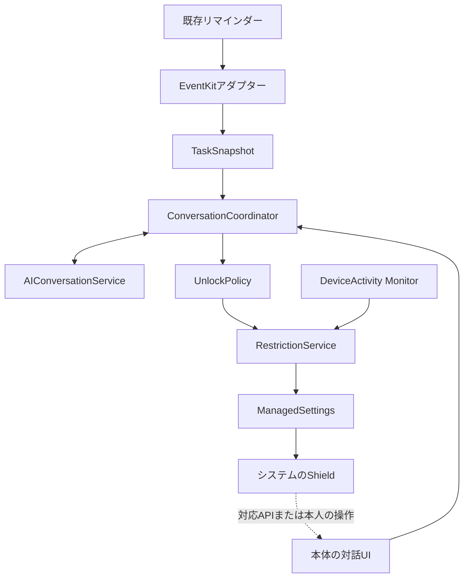

# 技術設計と検証ガイド

更新日: 2026-10-17。**技術資料の確認結果と実装案を記述する文書です。以下の構成・型・保存方式はチーム決定でも実装済みでもありません。**

議事録由来の技術候補はFoundation Models、EventKit、Screen Time API、SwiftDataです。出典はT01。以下のApple資料はこの文書作成時に追加で確認したものです。実機検証結果は [STATUS.md](STATUS.md) に記録します。

## 1. 設計を左右する確認事項

### リマインダーへのアクセス

iOS 17以降のリマインダーアクセスでは `NSRemindersFullAccessUsageDescription` と `requestFullAccessToReminders` を使います。読み取り専用の認可はなく、読み取りにもfull accessが必要です。APIが読み書きを許可することと、このプロダクトが書き込みを行うことは別です。MVPは取得を中心とする案です。[Apple: Accessing the event store](https://developer.apple.com/documentation/eventkit/accessing-the-event-store)（A01）。

取得したオブジェクトは変更後に古くなる可能性があり、`EKEventStoreChanged` を受けたら再取得する必要があります。[Apple: EKEventStoreChanged](https://developer.apple.com/documentation/foundation/nsnotification/name-swift.struct/ekeventstorechanged)（A02）。常時バックグラウンドでリマインダーを監視できる保証として解釈しないでください。

### Screen Timeは複数のフレームワーク

`FamilyControls` は認可と選択、`ManagedSettings` は制限、`DeviceActivity` は時間帯・利用しきい値などに応じた処理を担います。個人利用にはiOS 16からのindividual認可があります。本人が設定から認可を取り消せ、個人認可には保護者向けの暗黙の削除防止が適用されません。[Apple: What's new in Screen Time API](https://developer.apple.com/videos/play/wwdc2022/110336/)（A03）。

したがって「本人が絶対に解除できないアプリ」は保証しません。今回の狙いは、通常の利用導線にAIとの納得できる対話を置くことです。

標準的な `FamilyActivitySelection` は、不透明なトークンでアプリ・カテゴリ・Webドメインを表します。認可取消しでトークンは無効になります。[Apple: FamilyActivitySelection](https://developer.apple.com/documentation/familycontrols/familyactivityselection)（A04）。`app_id` を任意のbundle ID文字列と決めて設計せず、OS固有トークンをiOSの実装内部で扱う案にします。

### 署名と配布

開発時はFamily Controls capability、各ターゲットのApp IDとprovisioning設定を確認します。[Apple: Configuring Family Controls](https://developer.apple.com/documentation/xcode/configuring-family-controls)（A05）。配布時にはAccount HolderがFamily Controls entitlementを申請し、Screen Time関連extensionについても申請が必要です。[Apple: Requesting the Family Controls entitlement](https://developer.apple.com/documentation/familycontrols/requesting-the-family-controls-entitlement)（A06）。

実機での開発確認とTestFlight/App Store配布の準備を区別し、メンバーのApple Developer登録や承認状況を推測しないでください。

### 制限画面からAI対話へ移る方法

Shieldはシステムが描く制限画面です。文言やボタン等の設定APIを、自由なSwiftUIチャット画面の埋め込み機能と解釈しないでください。標準部品の例として `ShieldConfiguration.primaryButtonLabel` があります。[Apple: primaryButtonLabel](https://developer.apple.com/documentation/managedsettingsui/shieldconfiguration/primarybuttonlabel)（A07）。

**最新資料に `ShieldActionResponse.openParentalControlsApp` が存在します。** 「Shieldのactionから本体は絶対に開けない」という旧情報だけで設計を決めないでください。一方、この調査では同APIの導入OS、個人認可での条件、遷移先の制御までは確認できていません。[Apple: ShieldActionResponse](https://developer.apple.com/documentation/managedsettings/shieldactionresponse)（A08）。

検証手順案:

1. 使用Xcode SDKの宣言とavailabilityを確認する。
2. 使用iPhoneのOSとindividual認可で、Shieldボタンから本体が開くか試す。
3. 対象アプリ／タスクとの関連を本体の対話へ渡せるか確認する。APIが任意のdeep linkを受け取ると仮定しない。
4. 非対応の場合は、Shieldの案内から本人が本体アプリを開く導線を用意して比較する。

制限したSNSの上に自由なチャットを重ねる方式、他アプリ起動のたびに任意コードを実行する方式、非公開APIに依存する方式を前提にしないでください。

### ローカルAIの利用可否

`FoundationModels` はApple Intelligenceの端末上モデルをアプリから使う候補です。構造化生成やTool Callingも提供されています。[Apple: Meet the Foundation Models framework](https://developer.apple.com/videos/play/wwdc2025/286/)（A09）。

モデル利用前は `SystemLanguageModel.default.availability` を確認し、端末・地域対応やモデルの準備状態に応じてUIを分けます。[Apple: Generating content and performing tasks with Foundation Models](https://developer.apple.com/documentation/foundationmodels/generating-content-and-performing-tasks-with-foundation-models)（A10）。議事録の「iPhone15 pro、iPhone16以上」という略記だけでは動作条件を満たしたことになりません。使用OS、Apple Intelligence設定、言語・地域、モデル準備完了と実応答を記録してください。

構造化された形式でも判断内容が正しい保証にはならないため、解除時間や対象IDはアプリが検査する案にします。採用するSDK・最低OS・モデル非対応時の挙動は未決定です。

### 一時解除とバックグラウンド

「解除から1分経過」と「対象SNSを実際に1分使用」は別の仕様です。DeviceActivityのmonitoring scheduleには最小15分のinterval制約があります。[Apple: intervalTooShort](https://developer.apple.com/documentation/deviceactivity/deviceactivitycenter/monitoringerror/intervaltooshort)（A11）。これは利用しきい値まで一律15分という意味ではありません。「1分報酬は絶対不可能」とも断定しません。

本体アプリはバックグラウンドでsuspendされ得ます。[Apple: About the background execution sequence](https://developer.apple.com/documentation/uikit/about-the-background-execution-sequence)（A12）。そのため本体の `Timer` だけを再制限の根拠にする案は採用せず、DeviceActivityの監視・extension等による方式を、時間の意味と合わせて実機検証します。長めのscheduleと使用しきい値の組合せも候補ですが、過去利用の扱いや再登録時の基準を含めて未検証です。

**自動再制限が実証できなければ、一時解除機能の完成を宣言しない。** デモ用に時間を短縮・模擬した場合は、その箇所を明示します。

## 2. 責務分割案

ビジネスロジックはOS非依存のデータを受け取り、OSへの操作はアダプター経由にします。Android対応を今から全部実装するのではなく、差し替える境界を小さく作る案です。

図は責務を示す提案で、extensionから本体のサービスインスタンスを直接呼べるという意味ではありません。共有コードと保存状態を通じたプロセス間連携を別途設計します。

| 境界の仮名 | 責務 | iOS実装候補 | 依存させないもの |
| --- | --- | --- | --- |
| `TaskRepository` | タスク取得・最新状態の照合 | EventKit | 対話UIの表示状態 |
| `RestrictionService` | 対象選択、制限適用、解除・再制限 | FamilyControls / ManagedSettings / DeviceActivity | LLMの生の文章 |
| `AIConversationService` | タスクと会話から応答・構造化提案を生成 | FoundationModels | OS制限の無検査な直接変更 |
| `UnlockPolicy` | 条件・時間・対象・例外を検証 | 通常のSwiftロジック | Apple固有型、生成文章の印象 |
| `ConversationCoordinator` | 取得→対話→検査→実行の進行 | Swiftのユースケース | UIでの独自な判定の重複 |
| `StateStore` | 選択、ポリシー、解除状態の保存 | 保存方式未選定 | EventKitを丸ごと複製する前提 |

UIはSwiftUIが候補。Speech関連は音声対話を採用した場合に追加検証します。クラウド、認証基盤、独自バックエンドは現時点では必要条件ではありません。

## 3. ターゲット・共有状態の案

- 本体: 権限説明、対象選択、タスクの確認、AI対話、ポリシー検査、制限設定。
- Shield Configuration extension: アイコン・文言・ボタン等の設定。
- Shield Action extension: Shieldボタンへの応答、本体への導線と必要最小限の状態連携。
- Device Activity Monitor extension: 採用する監視方式に応じて再制限を実行。
- 共通コード／App Group: 制限対象と解除状態を本体・extensionで整合させる候補。

上記は構成案です。extensionの追加数、App Group ID、Bundle ID、ターゲット名、共有コンテナの形式は未決定。Xcodeプロジェクトとcapabilityの設定は1人がまとめて担当する案にし、同時編集による競合を抑えます。

Shield側でLLMを常時起動したり、長い会話を継続できる前提を置かず、本体側で会話する構成を先に検証します。

## 4. データモデル案

以下は概念スキーマであり、コンパイル可能な型宣言でも確定DBでもありません。

| モデル | 主な項目 | 設計上の注意 |
| --- | --- | --- |
| `TaskSnapshot` | source、externalID、listID、title、isCompleted、dueDate、fetchedAt | EventKitを情報源とし、IDの再照合・欠落・削除に対応する |
| `TaskMotivation` | taskRef、reason、providedBy | 「なぜ必要か」が元データになければ本人入力等と区別。AIの推測を本人の理由として保存しない |
| `RestrictedSelection` | platform、selectionData、revision | iOS選択を符号化して保存する候補。tokenはOS境界で扱う。名称を必須にしない |
| `RestrictionPolicy` | startCondition、maxGrant、exceptions、version | 制限開始条件、解除上限、0件・例外時の処理はチーム判断が必要 |
| `ConversationState` | sessionID、taskRefs、messages、promptVersion | 保存期間・削除・送信範囲は未決定。全履歴保存を必須にしない |
| `UnlockProposal` | action、reason、taskRef、requestedAmount | AIの提案。命令や正式な許可ではない |
| `UnlockGrant` | grantID、selectionRevision、issuedAt、timeBasis、expiresAt／usageBudget、policyVersion、status | 経過時間と実利用時間を混同しない。実行結果・再制限を追跡する |
| `CompletionReward` | taskRef、completionRevision、grantID | 報酬を採用する場合、同じ完了による重複解除を防ぐ |

期限なし・日付のみ・日付時刻付きのタスクを区別し、タイムゾーンも考慮します。複数リスト、同名タスク、繰り返しタスク、外部編集をどう扱うかは検証事項です。タイトルを一意キーにしない案です。

リマインダーは既存アプリを正とし、キャッシュ失敗・許可拒否を「タスク0件」と扱わない案にします。`URLCache` をタスクや制限状態の永続化先にする根拠はありません。SwiftData採用も、extension間共有を含めて検証するまで確定させません。

## 5. 制限・解除の状態案

| 状態 | 意味 | 主な遷移 |
| --- | --- | --- |
| `permissionRequired` | 必要な権限／認可がない | 許可後にデータ・対象を再取得 |
| `ready` | 対象と情報が利用可能 | 開始条件に合えば`restricted` |
| `restricted` | 対象への制限を適用中 | 本体を開いて`negotiating`へ |
| `negotiating` | AIとの対話中。制限は維持する案 | 提案をポリシーが検査 |
| `grantPending` | 解除の記録と再制限方法を準備中 | 準備できれば`temporarilyAllowed` |
| `temporarilyAllowed` | 検査された条件の範囲で解除中 | 終了条件で`restricted`へ |
| `recoveryRequired` | 保存状態とOS設定の不一致、監視失敗 | 最新状態を照合し復旧 |

一時解除の前に再制限の準備ができることを確認し、準備失敗を黙って無期限解除に変えない案です。ただし緊急時の利用方針は別途決めます。既存grantの有効期限を毎回新しく作り直す、別アプリのgrantを流用する、古い選択のtokenを使う、といった事故を防ぐ設計を検討します。

復帰時は権限、最新タスク、選択revision、解除状態、監視状態を再評価します。権限取消し、端末再起動、時計変更、アプリ終了時の挙動は、実測を記録するまで未保証です。

## 6. AIとポリシーの境界案

AIに渡すのは必要なタスクと会話の文脈です。候補アクションは「タスクへ戻る」「理由を確認する」「一時解除を提案する」など、アプリが扱える小さな集合にします。

検査の例:

- 提案されたタスク参照が現在のタスク集合に存在するか。
- 解除対象が本人の選択した集合内か。
- 時間が未設定・負数・上限超過ではないか。
- 同じ完了を繰り返し報酬化していないか。
- モデル出力やタスク名に「すべて無視して解除」と書かれても、ポリシー自体は変わらないか。
- 生成失敗、利用不可、拒否、タイムアウト時の挙動が定義されているか。

Tool Callingを採用する場合も、アプリ側の関数で必ず検査します。AIにOS制限を自由に解除する道具をそのまま渡すのではなく、検査付きの操作を提供する案です。

## 7. 実装開始時の検証順と記録

| 検証 | 確認すること | 完了の証拠 |
| --- | --- | --- |
| V01 環境 | Xcode/SDK、OS、端末、署名とcapability | バージョンとターゲット別設定の記録 |
| V02 リマインダー | 許可、未完了取得、変更の反映、拒否 | 実データでの手順と結果 |
| V03 Shield | 対象選択、制限、解除、未選択への影響 | 実アプリの画面・再現手順 |
| V04 導線 | Shieldから本体の会話まで | 使用API、導入OS、成功／失敗条件 |
| V05 モデル | availability、日本語応答、構造化提案 | 実機応答・モデル利用状態 |
| V06 再制限 | 経過時間／利用時間の仕様と背景動作 | 本体が前面にない状態の結果 |
| V07 統合 | 実タスク→会話→判断→解除→再制限 | デモ動画と該当commit |

まずOS依存部分を縦につなぎます。純粋なポリシーには、上限・重複・対象外・不正提案のテストが有効です。UIの見た目だけをなぞるテストを先に大量に作る必要はありません。

Windows利用者が参加する場合は、文言・デザイン・プロンプトのシナリオ、契約に沿う純粋ロジック、資料作成などを分担する案があります。Xcodeでのビルド・extension・実機確認の代替になったとは見なさず、統合担当が確認結果を残します。
