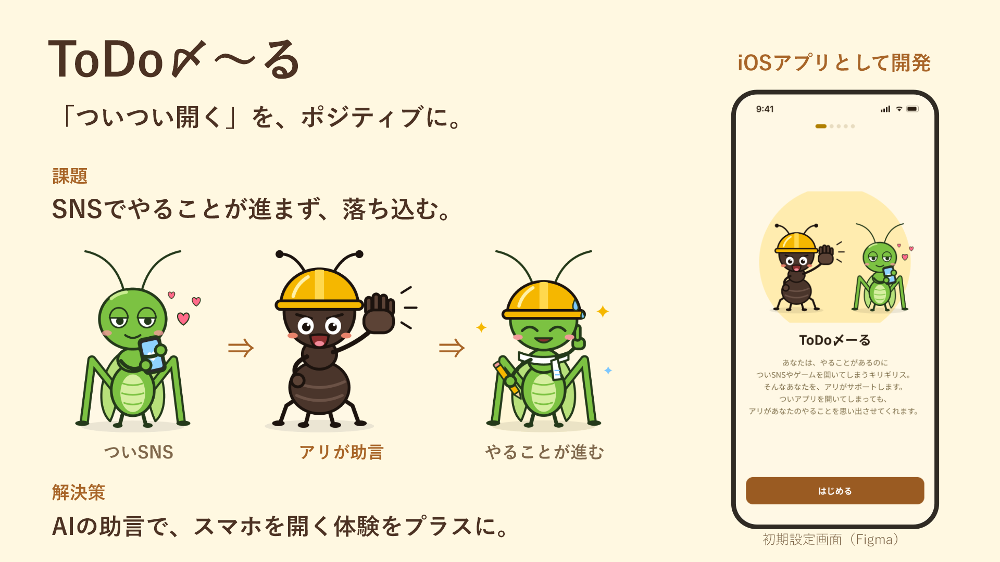

# 発表スライドと実機デモ台本

更新日: 2026-10-18。別チャット「審査基準に沿ってドラフトを変更」で作成・修正した発表資料を、ユーザーの依頼でリポジトリへ収録しました。

| 資料 | 用途 |
| --- | --- |
| [todomeru-overview.pptx](todomeru-overview.pptx) | 最新版の1枚スライド。PowerPointで文字を編集できます |
| [todomeru-overview.png](todomeru-overview.png) | 同じスライドのプレビュー |
| [demo-script.md](demo-script.md) | 90秒の実機デモ予定と、説明役・操作役の台本 |

スライドは「ついついスマホを開く」を前向きな体験に変える課題・解決策を示し、アリとキリギリス、右側の初期設定画面、スマホの外枠と時系列の矢印を配置した版です。別チャットの最終成果物を内容を変えずに収録しています。右側はFigmaの初期設定画面で、実機やシミュレーターの画面キャプチャではありません。

既存の [final.marp](../final.marp) と [final.pdf](../final.pdf) は別の発表資料として残しています。今回追加した1枚スライドと自動で同期するものではありません。

画像・キャラクターは既存のアプリ素材を使用しています。Figmaの画面や発表台本にある操作予定は、実機で検証済みであることを示しません。実演用端末・AIの種別・確認結果は [STATUS.md](../docs/STATUS.md)、Instagramのデモ導線は [SHORTCUTS_DEMO.md](../docs/SHORTCUTS_DEMO.md) を確認してください。
